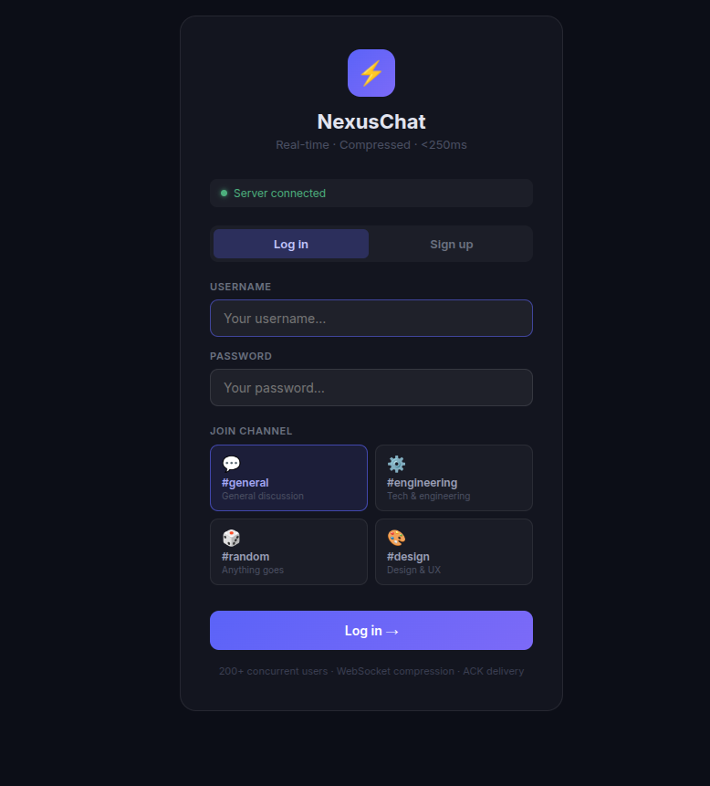
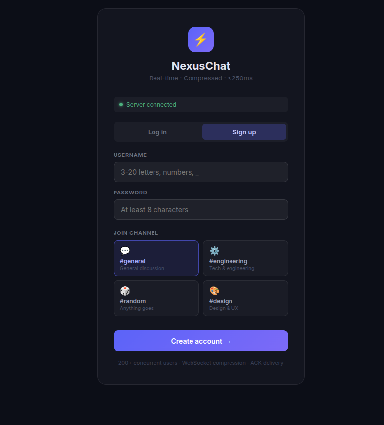
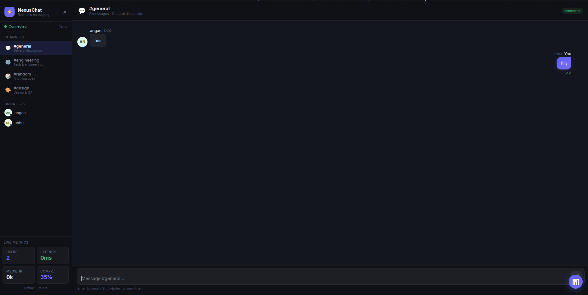
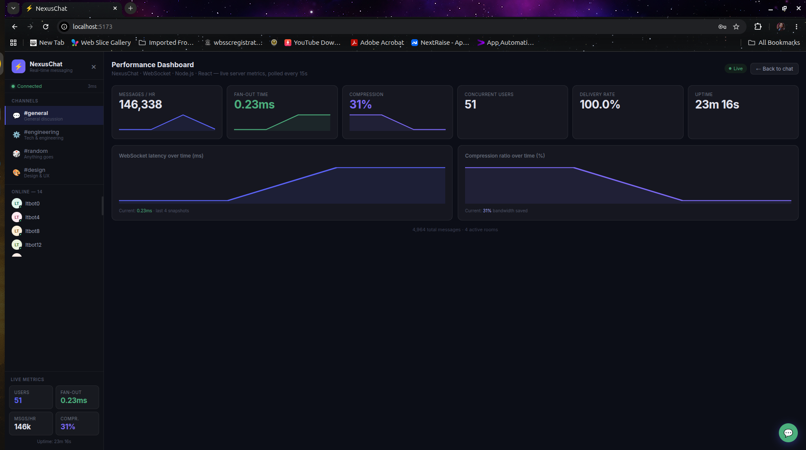

# ⚡ NexusChat — Real-Time Chat Application


> **Stack:** React 18 · TypeScript · Node.js · Express · WebSocket (`ws`) · Vite

A real-time chat app with room-based messaging, delivery receipts, typing indicators, and a live metrics dashboard — built to explore WebSocket connection handling, message delivery guarantees, and payload compression at scale.

---

## Live demo

[Deploy your own copy on Render](https://render.com/deploy?repo=https://github.com/ishani1813/nexus-chat)
using `render.yaml` (free tier, no credit card). Spins up the WebSocket
backend and the static frontend as two services and wires them together
automatically.

---

## Screenshots

<table>
<tr>
<td></td>
<td></td>
</tr>
<tr>
<td></td>
<td></td>
</tr>
</table>

---

## Features

- 4 chat rooms — general, engineering, random, design
- Message history (last 100 per room) delivered on join
- Real-time typing indicators with 3s auto-clear
- Delivery receipts per message (sending → sent → delivered)
- Message grouping — consecutive messages within 60s are grouped
- System events — join/leave shown inline
- Exponential backoff reconnection (up to 6 retries)
- Live metrics dashboard — connected users, latency, messages/hour, compression ratio (measured live via `zlib.deflateRawSync` on each broadcast, not an assumed constant)
- Fully responsive — mobile hamburger menu + slide-over sidebar
- Basic abuse protections — 2,000-character message cap, 10 messages/sec per connection, and rate-limited auth endpoints (10 attempts/15 min/IP)

---

## Architecture

```
nexus-chat/
├── package.json                        ← root runner (concurrently)
│
├── server/
│   ├── package.json
│   ├── loadtest.mjs                    ← WS load-testing script (see Performance below)
│   └── src/
│       ├── server.ts                   ← Express + WebSocket server
│       └── types.ts
│
└── client/
    ├── package.json
    ├── vite.config.ts
    ├── index.html
    └── src/
        ├── main.tsx
        ├── App.tsx                     ← root state + WS orchestration
        ├── index.css
        ├── hooks/
        │   └── useWebSocket.ts         ← connection, reconnect, ACK, ping/pong RTT
        ├── components/
        │   ├── Avatar.tsx
        │   ├── MessageBubble.tsx       ← grouping, delivery status, system msgs
        │   ├── Sidebar.tsx             ← rooms, users, live metrics panel
        │   ├── ChatWindow.tsx          ← messages list, typing indicator, input
        │   ├── JoinScreen.tsx          ← username + room picker
        │   └── MetricsDashboard.tsx    ← live charts: latency, throughput, compression
        └── utils/
            └── helpers.ts              ← formatters, avatar, grouping
```

**Key implementation details:**
- **Compression** — `perMessageDeflate` enabled on the WebSocket server (`server/src/server.ts`), with a 128-byte threshold so small control messages aren't wasted on compression overhead.
- **Session management** — `Map<socketId, Session>` and `Map<roomId, Set<socketId>>` for O(1) session lookup and O(n) room fan-out, with a 30s heartbeat to cull dead connections.
- **Delivery guarantees** — every client message gets a server-side ACK (`message_ack`) with a delivered-recipient count; the client shows optimistic "sending" state until the ACK lands.
- **Reconnection** — `useWebSocket.ts` implements exponential backoff (up to 6 retries) with promise-based ACK timeouts (5s) and ping/pong RTT tracking.

---

## Performance

This repo ships the load test used to measure these numbers: [`server/loadtest.mjs`](server/loadtest.mjs). Raw output from every run is in [`docs/`](docs/).

**Setup:** 12th Gen Intel(R) Core(TM) i5-1240P, 15Gi RAM, Node v22.23.3. The server and the bots ran on the same machine (loopback), and all bots ran in a single Node process, so treat these as a lower bound, not a production capacity claim.

Reproduce:

```bash
cd server
BENCHMARK_MODE=1 npm run dev     # terminal 1: relaxes the auth rate limiter; local benchmarking only, never set on a deployed server
node loadtest.mjs 200 20 2500    # terminal 2: clients, seconds, send interval (ms)
```

The first run registers the bot users (bcrypt), so it starts slowly; that time is outside the measured window.

| Scenario | Clients | Messages/s | Errors | Ack RTT p50 / p95 / p99 | Delivery latency p50 / p95 / p99 | Fan-out deliveries/s |
|---|---|---|---|---|---|---|
| Baseline (3 runs) | 200 | ~65 | 0 | 5 / 11 / 33-39 ms | 3 / 8 / 29-34 ms | ~3,200 |
| Faster senders | 200 | ~270 | 0 | 3 / 20 / 46 ms | 2 / 17 / 41 ms | ~13,200 |
| More clients | 400 | ~130 | 0 | 8 / 241 / 348 ms | 5 / 236 / 345 ms | ~12,900 |

- Every message was acked, and every message reached every member of its room (e.g. 5,387 sent x 50 room members = 269,350 broadcasts received).
- Delivery latency is measured at the receiving client from a timestamp embedded in the message.
- Latency degrades at 400 clients on a single machine (p95 ~240 ms). I haven't isolated whether the server or the load generator is the limit.
- `/api/metrics` `msgsPerHour` counts unique messages over a rolling ~60 s window, extrapolated to an hour. `successfulDeliveries` counts fan-out copies (one message to N room members = N), and `avgLatency` is the server-side time in ms to fan a message out to its room, not network latency.
- The test traffic is synthetic and repetitive, so the dashboard's compression ratio overstates real-world savings.

---

## How to Run

### Prerequisites
- Node.js 18+

### 1. Install dependencies

```bash
npm install
npm install --prefix server
npm install --prefix client
```

### 2. Start both server and client

```bash
npm run dev
```

- **Frontend →** http://localhost:5173
- **Backend  →** http://localhost:4000
- **WebSocket →** ws://localhost:4000

Or run separately in two terminals:

```bash
# Terminal 1
npm run dev:server

# Terminal 2
npm run dev:client
```

---

## REST API Endpoints

| Endpoint | Description |
|---|---|
| `GET /api/health` | Server health check |
| `GET /api/metrics` | Live performance metrics |
| `GET /api/rooms` | All rooms with user counts |
| `GET /api/rooms/:room/history` | Last 100 messages in a room |

---

## WebSocket Message Protocol

| Type | Direction | Description |
|---|---|---|
| `welcome` | S→C | Handshake — sends socketId + rooms |
| `join` | C→S | Enter a room with a valid auth token |
| `joined` | S→C | ACK — sends history + users + metrics |
| `message` | C→S | Send a chat message |
| `message` | S→C | Broadcast to room |
| `message_ack` | S→C | Delivery confirmation + recipient count |
| `typing` | C↔S | Typing indicator (broadcast) |
| `switch_room` | C→S | Move to a different room |
| `room_switched` | S→C | Switch ACK — sends new history + users |
| `user_joined` | S→C | Broadcast when someone joins |
| `user_left` | S→C | Broadcast when someone disconnects |
| `ping` / `pong` | C↔S | Heartbeat + metrics refresh (RTT) |

---

## Authentication & Persistence

- **Auth** — `POST /api/auth/register` and `POST /api/auth/login` (bcrypt-hashed passwords, JWT issued on success). Joining a room over WebSocket requires a valid token; the server derives the username from the verified token, not from anything the client claims.
- **Persistence** — message history is stored in SQLite (`server/data/nexus-chat.db`), not in memory. Restarting the server no longer drops chat history.

| Endpoint | Description |
|---|---|
| `POST /api/auth/register` | `{ username, password }` → `{ user, token }`. Username: 3-20 chars, letters/numbers/underscore. Password: 8+ chars. |
| `POST /api/auth/login` | `{ username, password }` → `{ user, token }` |

## Known limitations

- Single-process — no horizontal scaling yet (would need a shared pub/sub layer like Redis to run multiple server instances behind a load balancer).
- Sessions/room membership (who's currently online) are still in-memory and don't survive a restart — a restart drops every live WebSocket connection regardless, so this one's inherent to any single-process server, not something a persistence layer alone fixes.
- On Render's free tier specifically, the SQLite file lives on ephemeral disk — persistent disks require a paid plan — so accounts and message history reset whenever the free-tier backend redeploys or spins down after inactivity. Fine for a demo, not for anything meant to keep data.
